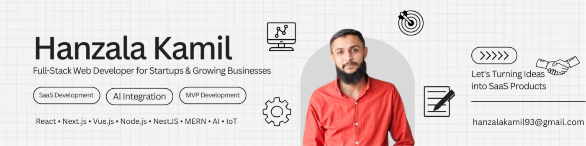

  

# Hey, I'm Hanzala Kamil 👋

### Full Stack Software Engineer | JavaScript & TypeScript Developer | IoT Engineer

  
  

I'm a passionate **Full Stack Software Engineer** focused on building scalable web applications, robust backend systems, modern frontend experiences, and IoT-powered solutions.

My development journey revolves around the JavaScript and TypeScript ecosystem, where I work across frontend, backend, cloud services, and smart device integrations.

I enjoy solving real-world engineering problems, designing efficient architectures, integrating third-party platforms, and transforming ideas into production-ready applications.

- Building scalable and responsive web applications.
- Developing RESTful APIs and backend architectures.
- Creating cross-platform and IoT-integrated solutions.
- Developing Tuya Smart Home MiniApps using **Ray.js**.
- Integrating TTLock smart locks, BLE communication, and Wi-Fi gateways.
- Working with relational and NoSQL databases.
- Exploring new technologies and continuously improving engineering skills.

---

## Tech Stack & Technologies

### Frontend Development

  

- HTML5, CSS3, JavaScript (ES6+), TypeScript
- React.js, Next.js, Vue.js
- Vite, Tailwind CSS, Bootstrap
- Responsive Web Design
- Component-Based Architecture
- State Management & API Integration

### Backend Development

  

- Node.js, Express.js, NestJS
- RESTful API Development
- MVC & Modular Architecture
- Authentication & Authorization
- JWT, Firebase Authentication
- Middleware & Exception Handling
- Background Jobs & Cron Scheduling
- Third-Party API & SDK Integrations

### IoT & Smart Device Development

  
  
  
  

- Tuya IoT Platform & Smart Home Ecosystem
- **Tuya Ray.js Framework**
- Tuya MiniApp Development
- TTLock API & SDK Integration
- Smart Lock Management Systems
- Bluetooth Low Energy (BLE)
- Wi-Fi Gateway Communication
- Remote Lock & Unlock Operations
- eKey, Passcode, Fingerprint & RFID Integrations
- IoT Device Pairing & Cloud Synchronization
- Smart Device Automation & Communication

### Databases & ORM

  

- MySQL & PostgreSQL
- MongoDB
- Supabase
- Firebase / Firestore
- Prisma ORM
- TypeORM
- Database Design & Query Optimization

### Mobile & Cross-Platform

  

- Flutter Integration
- React Native Ecosystem
- Firebase Integration
- Mobile API Integration
- BLE & Smart Device Connectivity

### Development Tools & Platforms

  

- Git & GitHub
- VS Code
- Postman
- Docker
- npm & pnpm
- API Testing & Debugging
- CI/CD Workflows
- Agile Development

---

## Areas of Expertise

| Area | Focus |
|---|---|
| Frontend Engineering | Modern UI, responsive applications, reusable components |
| Backend Engineering | Scalable APIs, authentication, business logic |
| Full Stack Development | End-to-end application development |
| IoT Engineering | Smart devices, cloud communication, device integration |
| Tuya Development | Ray.js, MiniApps, smart home solutions |
| TTLock Integration | BLE, gateways, eKeys, passcodes and remote access |
| Database Engineering | Schema design, ORM, optimization |
| API Integration | Third-party APIs, SDKs and cloud services |

---

## Featured Projects

Some areas of development I work on:

- **MindLogs:** Emotional journaling application with AI-powered insights, analytics, and subscription integration.
- **Alpha Access:** Smart lock management platform with TTLock integration, BLE connectivity, remote access, eKeys and gateway support.
- **Tuya MiniApps:** Smart home control panels and IoT interfaces developed using Tuya's Ray.js ecosystem.
- **Full Stack Applications:** Web platforms, backend services, authentication systems and database-driven applications.

---

## GitHub Statistics

  
  

  

### Contribution Activity

  

---

## Currently Exploring

- Advanced Backend Architecture & System Design
- Scalable Microservices
- Advanced TypeScript Patterns
- IoT Ecosystems & Smart Home Automation
- Cloud Infrastructure & DevOps
- AI-Powered Application Development

---

## Let's Connect & Collaborate

I'm always interested in working on challenging projects, exploring emerging technologies, and collaborating with developers worldwide.

  

**"Building scalable software, connecting smart devices, and turning ideas into reality."**

---

  <b>Thanks for visiting my profile!</b>
   
  <i>Keep Building. Keep Learning. Keep Growing.</i>

